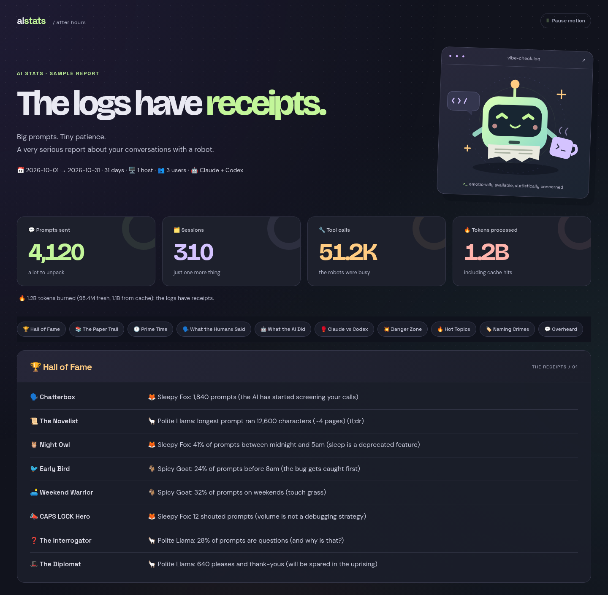

<div align="center">

# AI-Stats

**The logs have receipts.**

An attempt to recreate the good old days of IRC stats, like **PISG** — for your AI chats.


[](https://github.com/kawaiipantsu/aistats/actions/workflows/ci.yml)
[](LICENSE)

[Install](#install) · [First report](#your-first-report) · [Usage guide](docs/USAGE.md) · [Website](https://thugs.red)

</div>

Remember channel stats, night-owl awards, and the person who talked *far* too much?
AI-Stats brings that energy to Claude Code and Codex session logs: leaderboards,
swear jars, activity charts, token counts, and questionable life choices,
beautifully quantified.

It also collects AI usage and cost data into a local SQLite cache, with provider
sync, CSV/JSON imports, and reports you can read in a terminal or export.
One Rust binary. Your own machine. No hosted dashboard required.

<p align="center">
  
  <br />
  <sub>The real HTML report interface, with fictional sample figures and pseudonyms.</sub>
</p>

## What you get

| | |
| :--- | :--- |
| 🎭 **PISG-style fun stats** | Chatty humans, night owls, swear jars, AI quirks, and Claude vs. Codex comparisons. |
| 🎨 **An offline HTML dashboard** | A self-contained page with embedded styles, fonts, and artwork. No browser or Node.js needed to generate it. |
| 🔒 **Privacy-conscious summaries** | Fun stats use generated pseudonyms, counters, and curated labels instead of account names and raw chat logs. |
| 📊 **Usage and cost reports** | Sync OpenAI and Anthropic admin APIs; inspect local Ollama and LM Studio model inventories. |
| 📥 **Bring your own exports** | Import CSV or JSON usage records from other providers. |
| 📤 **Pick your format** | Fun stats: text, Markdown, HTML, JSON, Discord. Usage reports: text, Markdown, JSON, CSV, PDF, Discord. |
| 🖥️ **Optional multi-host collection** | Read logs over SSH using an explicit list of hosts. Local-only by default. |

## INSTALL

### From the THUGS(red) APT repository

Debian packages are available in the **zerotrust** suite for **AMD64 and ARM64**,
built against Debian 12 for Debian 12 and newer. Configure the repository using
its [official setup guide](https://apt.thugs.red/setup), including its dedicated
signing key, then install:

```bash
sudo apt update
sudo apt install ai-stats
ai-stats --version
```

The package installs `/usr/bin/ai-stats` and `man ai-stats`. To build everything
yourself instead, follow the source installation steps below.

### From source: Debian / Ubuntu / Raspberry Pi OS (64-bit)

The same commands work on **AMD64 / x86_64** and **ARM64 / aarch64**, including
64-bit Raspberry Pi OS. Compile on the machine where you intend to run AI-Stats;
Cargo selects its native architecture automatically. A 32-bit ARM OS is not part
of the tested platform set.

**1. Install the build tools:**

```bash
sudo apt-get update
sudo apt-get install -y build-essential curl ca-certificates git
```

**2. Install current stable Rust** with the [official Rust installer](https://rust-lang.org/tools/install/):

```bash
curl --proto '=https' --tlsv1.2 -sSf https://sh.rustup.rs -o /tmp/ai-stats-rustup.sh
sh /tmp/ai-stats-rustup.sh -y --profile minimal --default-toolchain stable
. "$HOME/.cargo/env"
```

Already using Rustup? Run `rustup update stable` instead. Use current stable Rust;
older distribution packages may not support the language features or dependencies.
SQLite is compiled into the binary, and HTTPS uses Rustls, so separate SQLite and
OpenSSL development packages are not needed.

**3. Download, compile, and install:**

```bash
git clone https://github.com/kawaiipantsu/aistats.git
cd aistats
cargo +stable install --path . --locked
export PATH="$HOME/.cargo/bin:$PATH"
ai-stats --version
```

Cargo builds an optimized binary and installs it to `~/.cargo/bin/ai-stats`.
Keep `~/.cargo/bin` on your shell's `PATH`; the Rust installer normally sets this
up for future terminals. Build as your regular user, without `sudo`.

On a machine with little RAM, replace the install command with:

```bash
CARGO_BUILD_JOBS=1 cargo +stable install --path . --locked
```

### Already have Rust and a C compiler?

```bash
git clone https://github.com/kawaiipantsu/aistats.git
cd aistats
cargo install --path . --locked
ai-stats --version
```

Use a current stable compiler. If you prefer a binary in the checkout, run
`cargo build --release --locked`, then use `./target/release/ai-stats`.
Source builds remain the default. Debian packages can also be built locally
and are available in the THUGS(red) APT repository; no GitHub releases are used.

## Build Debian packages

On Debian or Ubuntu, install the packaging tools alongside the build prerequisites:

```bash
sudo apt-get install -y binutils dpkg-dev make
make deb
```

The package is written to `dist/ai-stats_0.1.0-1_amd64.deb` or
`dist/ai-stats_0.1.0-1_arm64.deb`, according to your machine. Install it with:

```bash
sudo apt install ./dist/ai-stats_0.1.0-1_"$(dpkg --print-architecture)".deb
ai-stats --version
```

It installs `/usr/bin/ai-stats`, contains a manual page and the required license notices, and does
not bundle configuration, logs, or API keys. The package declares the minimum
glibc version required by the binary. Build on Debian 12 to target Debian 12 and
newer; a build on a newer distribution may require that newer runtime.

To cross-build ARM64 from an AMD64 Debian/Ubuntu machine:

```bash
sudo apt-get install -y gcc-aarch64-linux-gnu libc6-dev-arm64-cross binutils-aarch64-linux-gnu
rustup target add aarch64-unknown-linux-gnu
make deb ARCH=arm64
```

Use `DEB_VERSION=0.1.0-2 make deb` to set a new Debian package revision. Built
packages stay in the ignored `dist/` directory. Deployment credentials and
repository administration are kept outside this source tree.

## Your first report

### The fun part — no API key needed

If you already use Claude Code or Codex on this machine, paste:

```bash
ai-stats init
mkdir -p "$HOME/ai-stats-reports"
ai-stats --fun-stats --period all --format html \
  --output "$HOME/ai-stats-reports/index.html"
```

Open `~/ai-stats-reports/index.html` in a browser. On a desktop Linux system:

```bash
xdg-open "$HOME/ai-stats-reports/index.html"
```

On a headless machine, copy that file to your desktop and open it there.
The HTML is self-contained. If you have no local sessions yet, the page explains
that no sessions were found; generate some Claude Code or Codex history and rerun.

For a quick terminal recap:

```bash
ai-stats --fun-stats --period 30d
```

Run as your regular user to scan your own logs. Running as root scans all local
users, so use that only when you intend to include the whole machine. See the
[usage guide](docs/USAGE.md) for SSH collection, hosting, Discord, and retention.

### Usage and cost tracking

For provider reports, enable the provider you need and supply its **organization
admin API key**. A regular chat/project key is not a substitute. The following
Bash example prompts without displaying or saving the key in shell history:

```bash
ai-stats init
ai-stats config set providers.openai.enabled true
read -r -s -p 'OpenAI organization admin API key: ' OPENAI_ADMIN_API_KEY
printf '\n'
export OPENAI_ADMIN_API_KEY
ai-stats sync --provider openai
ai-stats report --provider openai --period 30d
unset OPENAI_ADMIN_API_KEY
```

Anthropic uses `providers.anthropic.enabled` and `ANTHROPIC_ADMIN_API_KEY`.
Configure only the providers you intend to use. Local Ollama and LM Studio
integration provides model inventory, not historical usage collection.

Import your own CSV/JSON records without provider credentials:

```bash
ai-stats import usage.csv --provider custom
ai-stats report --period all --format markdown
```

The [usage guide](docs/USAGE.md) covers the import schema, configuration keys,
report periods, pricing overrides, and every command.

## Update or uninstall

From your checkout:

```bash
git pull --ff-only
cargo install --path . --locked --force
```

Remove the installed binary with `cargo uninstall ai-stats`. Your configuration
and cached data remain under `~/.config/ai-stats/`.

## Your data stays yours

- Configuration, cache, pseudonym salt, and default reports live under
  `~/.config/ai-stats/`. `XDG_CONFIG_HOME` and `AI_STATS_CONFIG_DIR` can override it.
- Fun stats read local logs. SSH collection and Discord delivery are explicit
  opt-ins; provider sync contacts the providers you enable.
- Fun reports omit raw transcripts and account names. Stable pseudonyms and
  aggregate activity can still be recognizable on a small team: review reports
  before publishing them. Usage/billing reports can contain your model or
  provider identifiers and should be treated as private.
- Local configs, logs, databases, generated reports, keys, and development notes
  are ignored by Git. `.gitignore` does not protect a file already tracked or
  deliberately force-added; review staged changes before committing.

## Development

Native CI builds and tests run on Linux AMD64 and ARM64 using
[GitHub-hosted runners](https://docs.github.com/en/actions/reference/runners/github-hosted-runners).
To run the checks locally:

```bash
rustup component add rustfmt clippy
cargo fmt --check
cargo clippy --locked --all-targets -- -D warnings
cargo test --locked
python3 -B -m unittest discover -s src/fun -p remote_test.py
cargo build --release --locked
```

Python is only needed for these SSH-helper tests and on remote hosts used for
SSH collection. Node.js and Chromium are only needed to regenerate the bundled
social image, not to build or run AI-Stats.

[Architecture](docs/ARCHITECTURE.md) · [Dependencies](docs/TECHNOLOGY.md) ·
[Asset licenses](docs/ASSETS.md) · [Contributing](CONTRIBUTORS.md) ·
[Security](SECURITY.md)

## License

AI-Stats is [MIT licensed](LICENSE). Bundled fonts retain their SIL Open Font
License notices in [`assets/fonts/`](assets/fonts/).

Made for the stats page you used to check after everyone left the channel.
